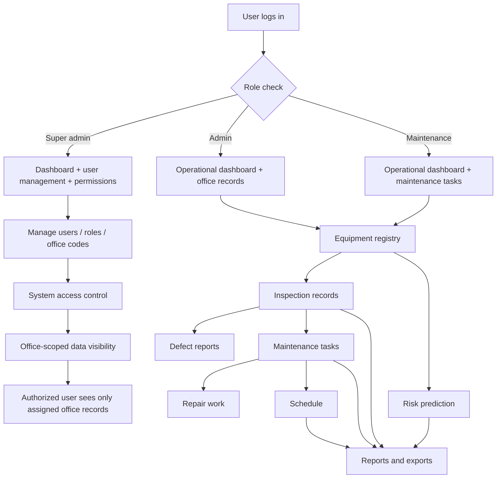

# FIRE-PMIS Project Manual

## 1. System overview

FIRE-PMIS is a web-based fire equipment and maintenance management system for tracking station assets, inspections, maintenance work, repairs, personnel assignments, risk predictions, and reporting.

The application is built with Laravel and follows a role-based access model. It supports:

- Super admin
- Admin
- Maintenance staff

The system is designed to help a fire service office manage equipment readiness, maintenance actions, overdue work, inspection defects, and operational reporting while keeping each office's records isolated by assigned office code.

## 2. User roles and permissions

The application defines the following roles in `app/Support/RolePermissionRegistry.php`:

- `super_admin` – unrestricted access across the system
- `admin` – access to operational modules and dashboard
- `maintenance` – access to operational modules and maintenance work

Important behavior:

- `super_admin` can manage users, roles, permissions, and audit screens.
- Admin and maintenance access is governed by module permissions in the database.
- Locked modules such as `user_management`, `roles_permissions`, and `audit_logs` are restricted from admin-level changes.
- Office-scoped queries limit records to the logged-in user's office when they are not a super admin.

### Role/default access summary

| Module | Super admin | Admin | Maintenance |
|---|---:|---:|---:|
| Dashboard | Yes | Yes | Yes |
| Equipment records | Yes | Yes | Yes |
| Inspections | Yes | Yes | Yes |
| Maintenance tasks | Yes | Yes | Yes |
| Repairs | Yes | Yes | Yes |
| Predictions | Yes | Yes | Yes |
| Schedule | Yes | Yes | Yes |
| Personnel | Yes | Yes | Yes |
| Defect Reports | Yes | Yes | Yes |
| Approvals | Yes | Yes | Yes |
| Reports | Yes | Yes | Yes |
| Settings | Yes | Yes | Yes |
| User management | Yes | No | No |
| Roles & permissions | Yes | No | No |
| Audit logs | Yes | No | No |

## 3. Main modules

### 3.1 Dashboard

The dashboard is the main landing screen after login.

- Super admin dashboard: system-level overview with counts for users, equipment, inspections, maintenance, and completed tasks.
- Admin dashboard: operational overview for equipment readiness, maintenance, overdue work, inspections due, and risk counts.
- Maintenance dashboard: staff-specific tasks, work progress, completed work, overdue work, assigned equipment risks, and upcoming maintenance.

Dashboard indicators include:

- equipment status totals
- overdue maintenance
- due inspections
- repair counts
- high-risk prediction counts
- completion and readiness metrics

### 3.2 Equipment records

This module stores all fire equipment inventory and station asset records.

Fields commonly tracked include:

- asset code
- equipment name
- category
- status
- location
- office code
- assigned user
- inspection and maintenance dates

Equipment records can be viewed, created, edited, and deleted by authorized users. Deleting an equipment record also removes linked inspection and maintenance history.

The equipment table displays each asset's latest risk classification. Super admins can add equipment categories, which then become available in equipment forms. Authorized equipment users can bulk import records from CSV using the downloadable template; imports support up to 500 records and are validated as a complete file before anything is saved.

### 3.3 Inspections

Inspections record equipment condition findings and defect information.

Typical inspection data:

- reference number
- equipment record
- inspection type
- inspector name
- inspection date
- outcome
- defects identified
- recommended action

This module feeds the defect report and schedule functions.

### 3.4 Maintenance and repairs

This module records planned and corrective work.

Useful details include:

- request number
- equipment affected
- maintenance type
- technician
- start date
- completion date
- status
- reported issue
- next maintenance recommendation

Repairs are treated as operational maintenance work with status monitoring and scheduling.

### 3.5 Schedule

The schedule page consolidates:

- upcoming maintenance work
- repair tasks
- inspection dates
- due equipment inspection dates

This gives users a single operational timeline for prioritizing work.

### 3.6 Personnel

Personnel records show the people assigned to the office and their roles.

- name
- email / username
- office code
- role
- status

Super admins can assign office codes and update user roles.

### 3.7 Defect reports

This module surfaces only inspection records with defects.

It highlights:

- equipment affected
- defect description
- recommended action
- owner / inspector
- date
- outcome

### 3.8 Risk prediction

The system includes a prediction feature for equipment risk classification.

It tracks:

- equipment code
- prediction label
- confidence score
- prediction timestamp
- model version / training metadata

This supports proactive maintenance decisions based on historical inspection and asset data.

### 3.9 Reports

The reports module supports exporting operational data by period and grouping.

Available reports include:

- user activity
- equipment registry
- maintenance summary
- inspection summary
- risk predictions
- audit activity

Supported exports:

- PDF
- Excel
- CSV

### 3.10 User management and permissions

Only super admins can access user and permission configuration.

This includes:

- creating users
- updating roles
- assigning office codes
- adjusting module permissions for admin/maintenance roles

### 3.11 Settings

This screen provides general settings and operational preferences for the application shell.

## 4. Access and data scope rules

The application enforces office-based data visibility through `app/Support/OfficeScope.php`.

Rules:

- Super admins can see all data.
- Admins and maintenance users only see records for their assigned office.
- If a user has no office code, the system blocks access to personnel, equipment, and related records.

This helps keep each office from viewing or editing another office's records.

## 5. User workflow manual

### 5.1 Login and account setup

1. Open the login screen.
2. Enter valid email and password.
3. If the account is not verified, complete email verification.
4. If no office code is assigned, request a super admin to assign one.

### 5.2 Main operations workflow

1. Log in to the dashboard.
2. Review equipment status, inspection due dates, and maintenance workload.
3. Open Equipment Records to add or update assets.
4. Add or review Inspections for each equipment record.
5. Create Maintenance Tasks or Repairs when work is required.
6. Use the Schedule to prioritize task dates and inspection follow-ups.
7. Review Defect Reports for unresolved issues.
8. Use Predictions to identify high-risk assets.
9. Export reports when needed for review or management approval.

### 5.3 Typical maintenance process

```text
Equipment inspection
        ↓
Defect or condition issue identified
        ↓
Create maintenance task or repair record
        ↓
Assign technician and set date
        ↓
Update status as work proceeds
        ↓
Complete task and record completion date
        ↓
Schedule follow-up maintenance if required
```

### 5.4 Typical admin process

```text
Review dashboard
        ↓
Check due inspections / overdue maintenance
        ↓
Open relevant records
        ↓
Action tasks and assign ownership
        ↓
Monitor schedule and progress
        ↓
Generate report exports
```

## 6. System flow diagram



## 7. Data flow summary

At a high level, the system follows this sequence:

1. A user signs in.
2. The app checks role and office scope.
3. Data is filtered to the current office unless the user is a super admin.
4. Equipment records are created or updated.
5. Inspections and maintenance actions reference equipment records.
6. Risk predictions are generated or reviewed against equipment history.
7. Reports summarize operational data across time periods and groupings.

## 8. Operational best practices

- Keep equipment asset codes accurate and consistent.
- Record inspection results immediately after each check.
- Update maintenance status as soon as work begins and ends.
- Use the schedule page to control backlog and avoid missed follow-ups.
- Ensure each user has a valid office code.
- Use reports to review overdue and high-risk assets regularly.

## 9. Notes and limitations

- Audit logging is not currently configured, so the audit log page shows no persisted events.
- Some configuration and permissions are controlled from the roles/permissions area and should be updated only by trusted super admins.

## 10. Quick reference

| Task | Main screen |
|---|---|
| View overall status | Dashboard |
| Manage assets | Equipment |
| Log inspection findings | Inspections |
| Record work orders | Maintenance |
| Track repairs | Repairs |
| See upcoming dates | Schedule |
| Review users | Personnel |
| View defects | Defect Reports |
| Review predictive risk | Risk |
| Export reports | Reports |
| Manage access | Roles & Permissions |

## 11. Support and maintenance

For production use, keep the following in mind:

- verify office-code assignments for all users
- review role permissions after onboarding or role changes
- monitor due inspections and overdue maintenance weekly
- review reports for asset readiness and defect trends
- ensure the risk model and predictions are retrained as needed

This system manual provides a practical guide to the main operational flow and user responsibilities within FIRE-PMIS.
